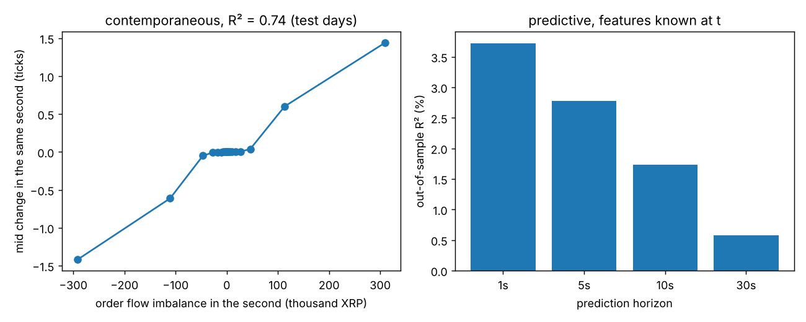
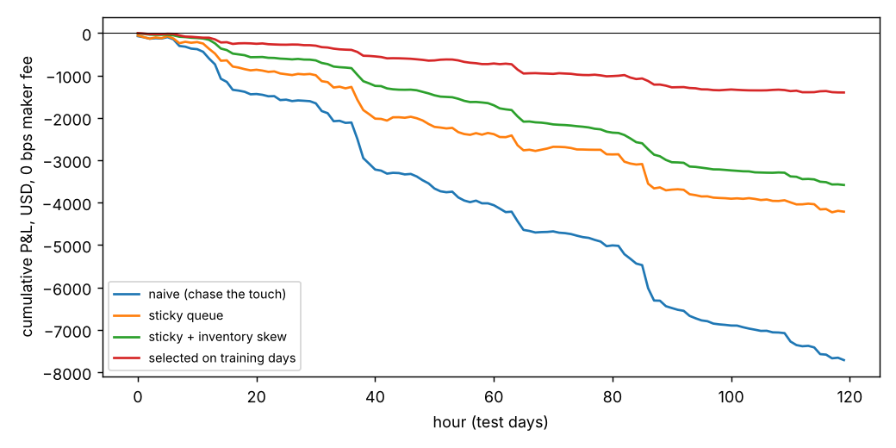

# Order Book and Market-Making Research

A C++17 limit-order-book matching engine, and an event-driven market-making backtester that replays real Binance futures data (top-of-book updates and trades, 10 days, about 60 million events). It also covers order-flow research on what moves prices over the next few seconds.

The headline finding is a negative one, and it is measured carefully. A passive market maker in XRP perpetual futures loses about 1 basis point per trade to adverse selection before fees. This holds whatever the quoting logic. Order-flow signals and inventory control cut daily losses by 82%, but they do it by trading less, not by trading better. Reacting faster does improve the quality of each fill, but not enough to break even.

## 1. Matching engine (`include/lob`, `src/order_book.cpp`)

- **Price-time priority.** Limit orders, market orders, cancel by id, and size reduction that keeps queue position.
- **Data structures.** Each price level is an intrusive doubly linked list, so add, fill-from-front and cancel are O(1) once the level is found. Levels live in sorted maps, with a hash index from order id to order. Order objects come from a pool rather than one heap allocation each (the id index still allocates its hash nodes).
- **Correctness.** A randomised test runs 20,000 mixed operations against a brute-force reference implementation. After every step it checks fills, best prices, order count and that the book never crosses.
- **Throughput.** 2.6 million operations per second, about 385 ns per operation (`bench_order_book`, 5 million operations of 60% limits, 30% cancels and 10% market orders, on a 4-vCPU cloud VM).

## 2. Market data and order-flow features (`src/market_data.cpp`, `src/features.cpp`)

- **Data.** Streams Binance USD-M `bookTicker` and `aggTrades` files straight from the zip archives and merges them by exchange timestamp. At equal timestamps trades come first, because the quote update already reflects the trade.
- **Order flow imbalance (OFI)** per Cont, Kukanov and Stoikov (2014), together with trade imbalance, book imbalance and microprice. These are computed over one-second buckets.
- **One definition for research and simulation.** The research export and the simulator share the same feature code, so the model is trained on exactly what the strategy sees live.

**Results.** XRPUSDT, 21 to 30 March 2024. The spread is 1 tick (1.6 bps) more than 99% of the time. Models were fitted on the first 5 days and tested on the last 5.

| | 1s | 5s | 10s | 30s |
|---|---|---|---|---|
| Out-of-sample R² of the next mid move | 3.7% | 2.8% | 1.7% | 0.6% |
| Sign accuracy when the model predicts a move above 0.5 tick | 86% | 79% | 72% | 61% |

- **Explaining moves.** The same second's OFI explains **74%** of that second's mid-price changes (out-of-sample R² 0.74). That replicates the main result of Cont et al.
- **Predicting moves.** Almost all of the forward-looking information is in the current book imbalance and microprice. Past OFI adds little.



## 3. Market-making simulator (`src/simulator.cpp`)

The real book only shows total size at each price, so our own fills have to be simulated. The rules are:

1. **Joining the best price** puts us at the back of the displayed queue.
2. **Trades at our price** consume the queue ahead of us before they reach us.
3. **Cancellations ahead of us.** If the displayed size drops below our position, the difference is assumed to have been cancelled ahead of us.
4. **Complete fills.** A trade through our price, or the opposite side moving onto it, fills us completely.
5. **Latency and post-only.** Every new order and cancel takes `latency_ms` to arrive. Orders are post-only: one that would cross on arrival is rejected.
6. **Accounting.** Inventory limits, maker and taker fees, and end-of-day flattening at the touch. Markouts measure where the mid price is 1, 10 and 60 seconds after each fill.

Strategies are layered so each idea can be measured on its own:

- **Naive:** always quote both sides at the best price.
- **Sticky:** keep a resting order up to *k* ticks behind the best price instead of cancelling, to preserve queue position.
- **Inventory skew:** back off one tick per 5,000 XRP of inventory on the side that would add to it.
- **Signal:** use the 5-second OFI model, and back off the side the price is predicted to run over.

32 combinations were run on the 5 training days. The best one (sticky 3, skew on, signal threshold 0.3 ticks) was then run once on the 5 test days.

**Test-day results.** Order size is 1,000 XRP, about $630. P&L is shown at a 0 bps maker fee; the other fee levels follow linearly.

| Strategy | Fills/day | Notional/day | 10s markout (ticks) | P&L/day | bps of notional | P&L/day at 2 bps fee | P&L/day at −0.5 bps rebate |
|---|---|---|---|---|---|---|---|
| Naive | 24,557 | $13.4M | −0.73 | −$1,543 | −1.15 | −$4,229 | −$871 |
| Sticky queue | 13,652 | $7.4M | −0.71 | −$842 | −1.13 | −$2,329 | −$471 |
| + inventory skew | 11,436 | $6.3M | −0.71 | −$717 | −1.14 | −$1,975 | −$402 |
| + OFI signal (selected) | 4,497 | $2.7M | −0.75 | −$280 | −1.06 | −$811 | −$148 |

**Reaction speed**, on the naive maker:

| | Fills/day | 1s markout (ticks) | bps of notional, 0 fee |
|---|---|---|---|
| Slow: 300 ms latency, requote every 500 ms | 18,110 | −0.63 | −1.17 |
| Base: 20 ms, 100 ms | 24,557 | −0.65 | −1.15 |
| Fast: 1 ms, requote on every event | 35,579 | −0.50 | −0.95 |



**What this says**

- **Fills are adversely selected.** A fill at the bid starts with a +0.5 tick markout, since the mid is half a tick above it. On average it ends up 0.7 ticks *below* the fill price 10 seconds later. In a large-tick market with a median of about 60,000 XRP queued at the best price, an order at the back of the queue fills mostly when the whole level is about to be eaten, which is exactly when the price is about to move against it.
- **Strategy logic changes how much you trade, not how well.** Loss per dollar traded stays between −1.06 and −1.15 bps across every strategy.
- **Speed is the one lever that improves fill quality.** It works by getting to new price levels earlier in the queue. This is consistent with the queue-position literature (Moallemi and Yuan). A passive maker needs that priority, or rebates larger than about 1 bp, to break even here.
- **Retail fees make it hopeless.** At the 2 bps maker fee, every configuration loses about 3 bps per dollar traded.

## Limitations

- **Level 1 only.** Only the best bid and ask are available, so deeper queue dynamics and hidden liquidity are approximations.
- **Our orders have no market impact.** Other participants do not react to us.
- **Optimistic cancellation assumption.** Assuming all cancellations happen ahead of us is generous; real queue position would be worse.
- **Narrow sample.** One instrument, 10 days in one week of March 2024.

## Build, test, run

```bash
cmake -S . -B build && cmake --build build -j
ctest --test-dir build                    # 23 GoogleTest tests (also run under ASan/UBSan in CI)
./build/bench_order_book 5000000

scripts/fetch_data.sh XRPUSDT 2024-03-21 2024-03-30 data && mkdir -p out
for d in $(ls data/*bookTicker* | sed 's/.*bookTicker-//; s/.zip//'); do
  ./build/features --tick 0.0001 --book data/XRPUSDT-bookTicker-$d.zip --trades data/XRPUSDT-aggTrades-$d.zip > out/features-$d.csv
done
python research/ofi_research.py out --train-days 5
python research/run_backtests.py --data data --out out
```

Full outputs from the runs above are in [docs/results](docs/results). A single simulated day (about 6 million events) runs in about 8 seconds.
